

#  Lottus Imobiliária 

> Visite o site: [Lottus Imobiliária - Landing Page](https://lottus-imobiliaria.vercel.app)

 

## Sobre o projeto

Landing page criada para o setor imobiliário, apresentada com a marca Lottus Imobiliária.

A página foi pensada para imobiliárias que trabalham com imóveis de alto padrão: mostra os imóveis em destaque com preço e ficha técnica (e um tour em vídeo pela casa, que avança com a rolagem), explica os diferenciais e o passo a passo do atendimento, reúne depoimentos de clientes, responde às perguntas frequentes e leva o visitante até o contato, pelo WhatsApp com a mensagem já escrita ou por um formulário.

O visual nasceu do nome: a flor de lótus, que floresce acima da água, virou o símbolo da marca e o slogan "Onde a vida floresce". Daí vieram o verde das folhas e o rosa das pétalas. Já as animações contam a história do próprio imóvel: uma cidade que cresce, uma casa que é construída e o caminho do primeiro café até a entrega das chaves, em cenas 3D guiadas pela rolagem.

 

## Prévia

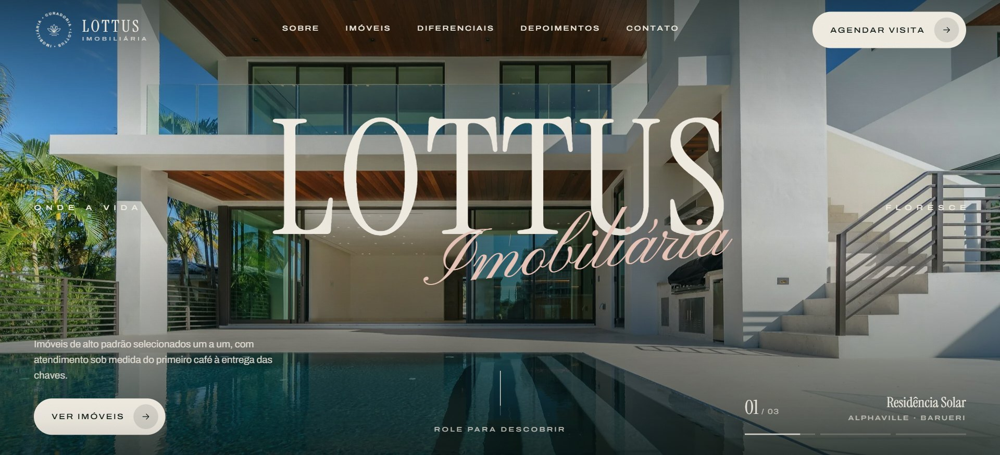

<table>
  <tr>
    <td width="50%">
      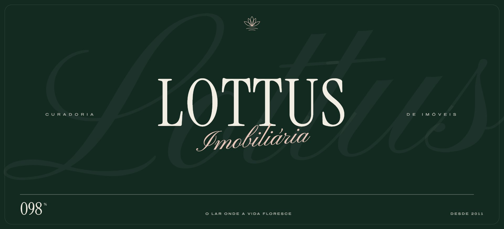
      
<b>Abertura animada</b> A lótus se desenha, as letras sobem e a cortina se abre

    </td>
    <td width="50%">
      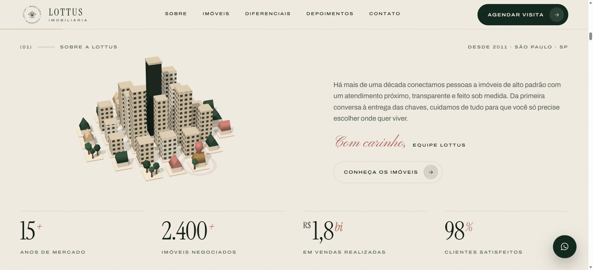
      
<b>Sobre a Lottus</b> Uma cidade em 3D cresce com a rolagem, os números contam junto e um pino pousa no "seu lugar"

    </td>
  </tr>
  <tr>
    <td width="50%">
      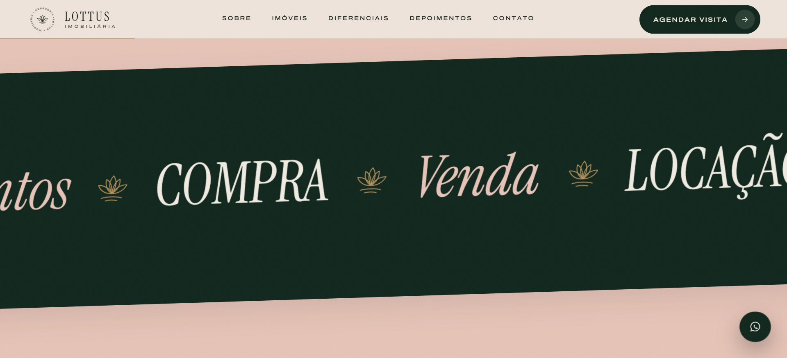
      
<b>Faixas que tomam a tela</b> As faixas engrossam até cobrir tudo e levam direto aos imóveis

    </td>
    <td width="50%">
      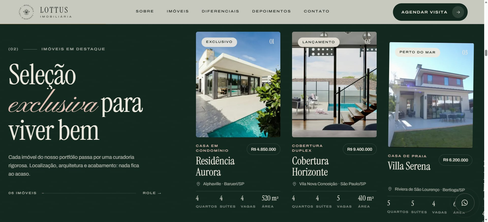
      
<b>Imóveis em destaque</b> A rolagem vertical vira um passeio horizontal; cada card abre o tour pela casa

    </td>
  </tr>
  <tr>
    <td width="50%">
      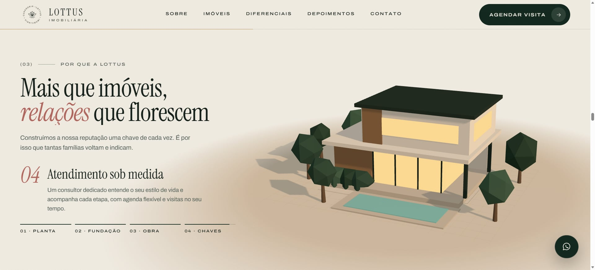
      
<b>Por que a Lottus</b> Uma casa é construída em 3D, da planta às luzes acesas, revelando cada diferencial

    </td>
    <td width="50%">
      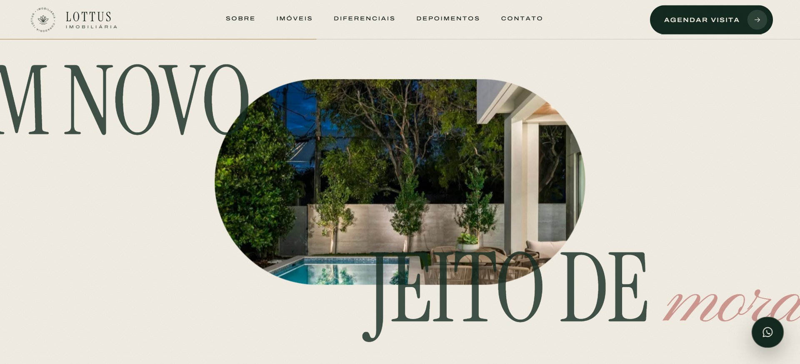
      
<b>Um novo jeito de morar</b> A foto se abre até ocupar a tela

    </td>
  </tr>
  <tr>
    <td width="50%">
      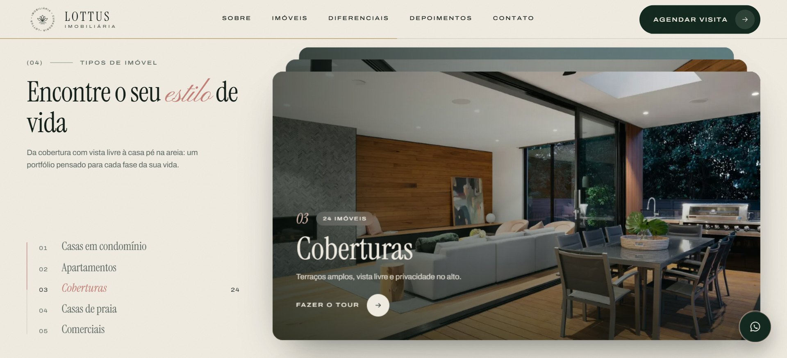
      
<b>Tipos de imóvel</b> Cada tipo sobe por cima do anterior, que recua e forma uma pilha

    </td>
    <td width="50%">
      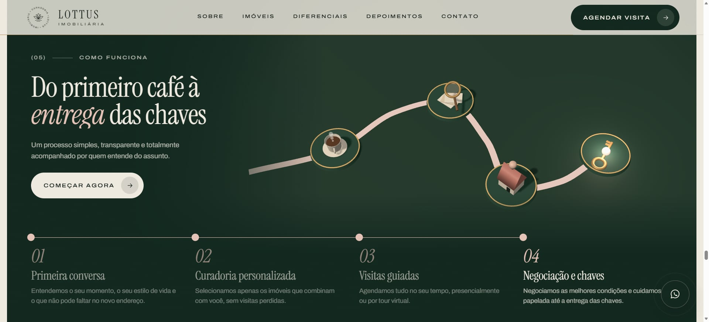
      
<b>Como funciona</b> Um caminho em 3D se desenha do primeiro café à entrega das chaves

    </td>
  </tr>
  <tr>
    <td width="50%">
      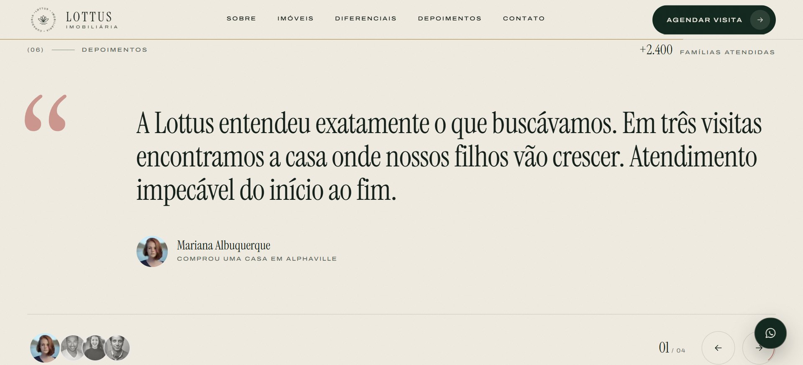
      
<b>Depoimentos</b> Citações que trocam palavra por palavra, com avanço automático

    </td>
    <td width="50%">
      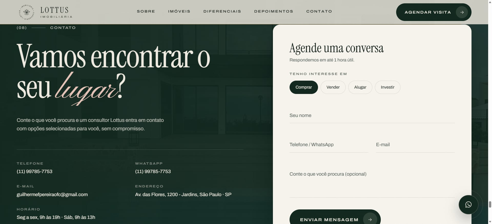
      
<b>Contato</b> Ao enviar, uma chave 3D gira na fechadura e a porta se abre com a confirmação

    </td>
  </tr>
  <tr>
    <td width="50%">
      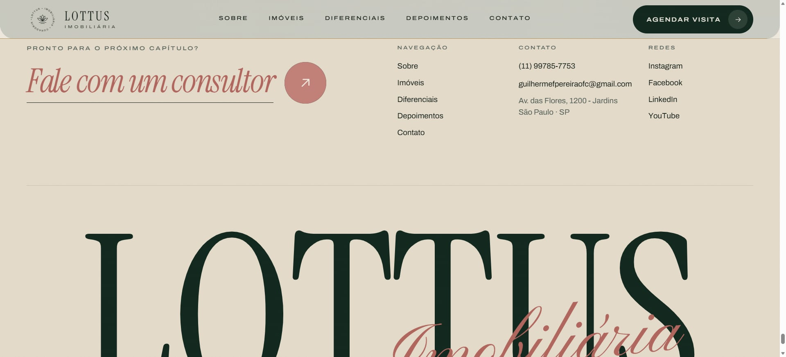
      
<b>Fale com um consultor</b> No hover, as letras rolam em cascata para o itálico e a seta se preenche

    </td>
    <td width="50%">
      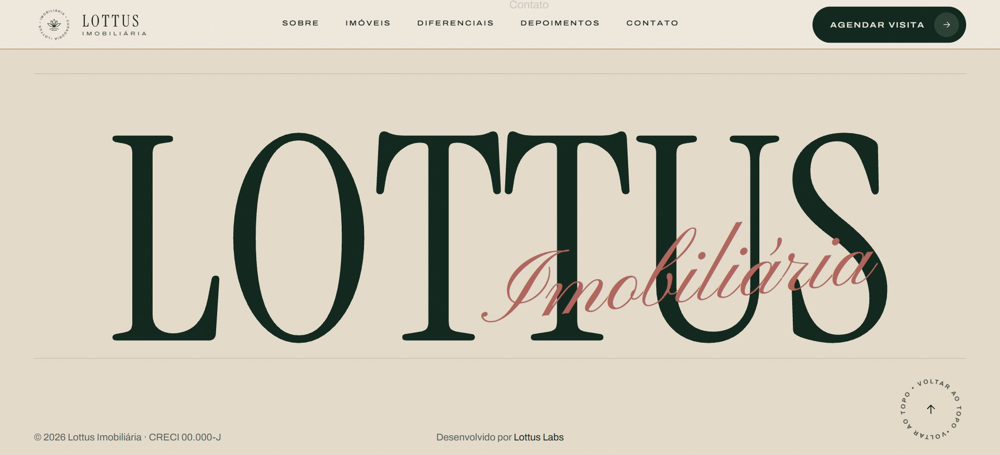
      
<b>Rodapé</b> Letreiro gigante que sobe letra a letra

    </td>
  </tr>
</table>

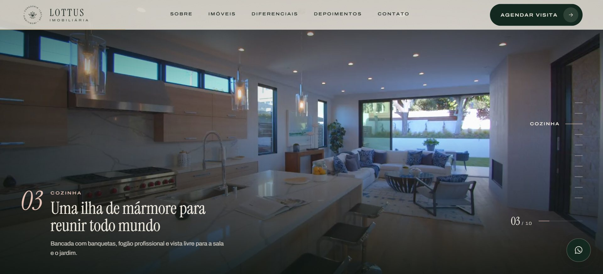

<b>Tour em vídeo</b> O vídeo da casa avança e volta com a rolagem, e a legenda troca a cada cômodo

### No celular

Boa parte de quem procura imóvel começa pelo celular, vindo do Instagram, de um anúncio ou do Google. Por isso a vitrine de imóveis vira um carrossel de deslizar, as cenas 3D ocupam a largura toda da tela, os tipos de imóvel se empilham um de cada vez, o tour usa um vídeo em pé e o menu ocupa a tela inteira. As telas fixas acompanham a barra do navegador do iPhone, que aparece e some durante a rolagem, e sempre chegam ao fim da tela.

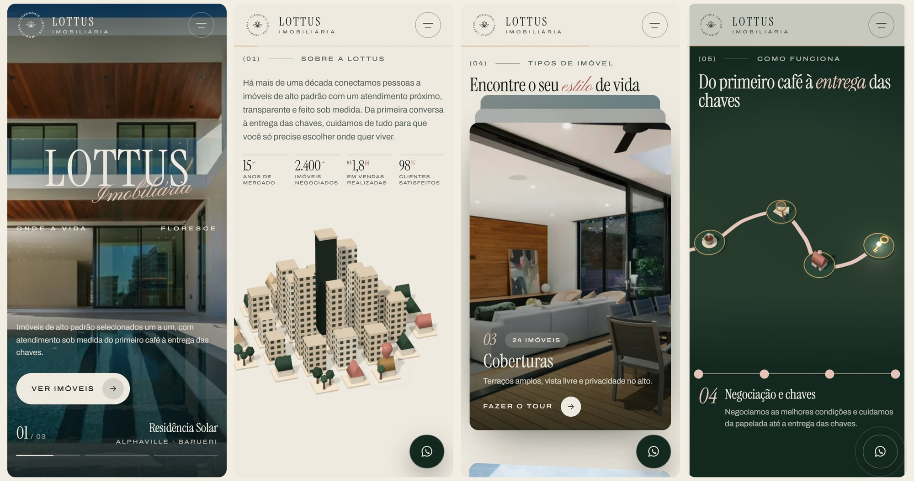

 

## Destaques

- **Abertura animada**: a flor de lótus se desenha em traço, as letras de "LOTTUS" sobem uma a uma, "Imobiliária" aparece como se fosse escrito à mão e um contador vai de 000 a 100. Na saída, duas cortinas com borda curva sobem e revelam o topo com zoom.
- **Topo com slides**: três fotos trocam com efeito de cortina e zoom lento, com o nome e o bairro de cada imóvel e barras de progresso. Ao rolar, o topo fica parado e a seção seguinte desliza por cima.
- **Cenas 3D guiadas pela rolagem**: em "Sobre a Lottus", uma cidade em miniatura cresce do centro para as bordas e um pino de localização pousa sobre uma casa; em "Por que a Lottus", uma casa é construída da planta às luzes acesas; em "Como funciona", um caminho se desenha do primeiro café à entrega das chaves, com uma luz passando por cada etapa. Os textos acompanham cada momento da cena e a câmera reage ao cursor.
- **Tipos de imóvel em pilha**: cada tipo é um card grande que sobe por cima do anterior, que recua, inclina e escurece; dá para pular direto para um tipo pela lista ao lado. Esses cards e os imóveis em destaque levam ao tour da casa.
- **Tour em vídeo guiado pela rolagem**: na página do imóvel, um vídeo em tela cheia avança e volta conforme você rola, como um passeio pela casa: são dez ambientes, do jardim à suíte, filmados em velocidade real e ligados por transições suaves. A legenda troca a cada cômodo, um trilho lateral leva direto a cada ambiente e, no fim, vêm a ficha do imóvel e o agendamento de visita pelo WhatsApp. O vídeo tem uma versão deitada e outra em pé, para o celular.
- **Animações guiadas pela rolagem**: texto que acende palavra por palavra, números que contam junto com a cidade, vitrine horizontal com parallax nas fotos e uma foto que se abre até ocupar a tela.
- **Faixas que tomam a tela**: duas faixas cruzadas com os serviços correm sem parar, aceleram, mudam de sentido e inclinam conforme a velocidade da rolagem; depois engrossam até cobrir a tela e emendam na vitrine de imóveis.
- **Mesma proporção em qualquer tela**: no computador, tudo escala a partir do notebook em que a página foi desenhada (1536 × 700), então um monitor maior mostra exatamente o mesmo enquadramento, sem precisar de zoom. As seções de uma tela ocupam 100% da altura.
- **Contato em um toque**: os botões de WhatsApp abrem a conversa com a mensagem pronta, um botão flutuante aparece depois do topo e o formulário tem máscara de telefone e uma confirmação em que a chave gira e a porta se abre.
- **Cabeçalho fixo**: selo circular que gira com a rolagem, barra de progresso de leitura e menu em tela cheia no celular e no tablet.
- **Acabamento nos detalhes**: botões magnéticos com preenchimento animado, links que "rolam" letra a letra no hover, o "Fale com um consultor" que vira itálico em cascata, perguntas frequentes em acordeão animado e rolagem suave em toda a página.
- **Fácil de adaptar**: nome, contatos, imóveis, perguntas, depoimentos, números e fotos ficam em um único arquivo, `src/data/site.ts`. Trocar de imobiliária é editar esse arquivo.
- **Responsiva**, sem rolagem lateral, testada do celular (390px) até telas largas (2560px).
- **Acessível**: respeita a preferência "reduzir movimento" do sistema (as cenas 3D aparecem prontas, o tour vira uma sequência de fotos e todos os textos ficam visíveis), tem navegação por teclado (o menu fecha com Esc), contraste de texto no padrão AA, textos alternativos nas fotos e rótulos nos botões.
- **Pronta para compartilhar**: ao enviar o link no WhatsApp ou nas redes sociais, a prévia mostra o topo do site com título e descrição. Tem favicon, ícone para a tela inicial do celular e manifesto.
- **Pronta para o Google**: título e descrição com palavras-chave, link canônico, sitemap (com as fotos e o vídeo do tour), robots, dados estruturados de imobiliária (endereço, horários e contatos), das perguntas frequentes (para as respostas aparecerem na busca) e do imóvel do tour, e verificação do Search Console pronta para ativar.
- **Rápida**: página estática gerada no build, CSS embutido no HTML, fotos otimizadas automaticamente em WebP e fontes servidas pelo próprio site. A abertura roda em CSS desde o primeiro quadro, as seções são ativadas uma de cada vez e o Three.js só é baixado quando o visitante começa a interagir e uma cena 3D se aproxima; cada cena para de desenhar quando sai da tela. No Lighthouse (build de produção, medido localmente): 98 a 99 de desempenho no desktop, 83 a 87 no celular e 100 em acessibilidade, boas práticas e SEO.

 

## Identidade visual

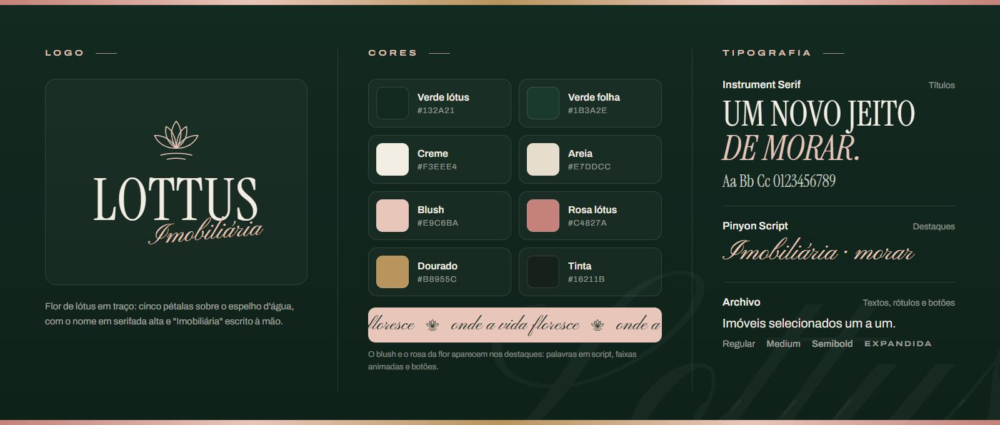

- **Logo**: a flor de lótus em traço, com cinco pétalas sobre o espelho d'água. Ela se desenha na abertura, fica dentro do selo giratório do cabeçalho e é o ícone do site.
- **Cores**: verde lótus e verde folha nos fundos escuros, creme e areia nos claros. O blush e o rosa das pétalas marcam os destaques, e o dourado aparece nos detalhes das faixas.
- **Tipografia**: Instrument Serif nos títulos, alta e elegante; Pinyon Script nas palavras em destaque, como "Imobiliária", "exclusiva" e "lugar"; Archivo nos textos, com a versão expandida nos rótulos e botões.

 

## Tecnologias

      

| Camada | Escolha |
| --- | --- |
| Framework | Next.js 16 (App Router), com a página gerada de forma estática |
| Interface | React 19 + TypeScript |
| Estilos | CSS Modules, sem frameworks de CSS |
| Animações | GSAP (ScrollTrigger e SplitText), animações em CSS e CSS 3D |
| 3D | Three.js, carregado sob demanda e sincronizado com a rolagem |
| Rolagem suave | Lenis, sincronizado com o ScrollTrigger |
| Imagens e fontes | `next/image` e `next/font` |

 

## Direitos

A marca Lottus, o design e o código deste projeto pertencem ao autor. As fotos são do [Unsplash](https://unsplash.com) e o vídeo do tour é de [Kindel Media, no Pexels](https://www.pexels.com/video/video-of-a-house-interior-7578546/); servem apenas para demonstração. Os imóveis, preços, depoimentos e números exibidos são fictícios.

<!-- Desenvolvido por: Guilherme Francisco Pereira-->